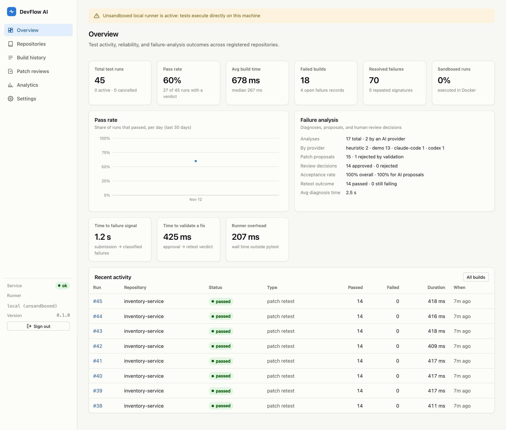
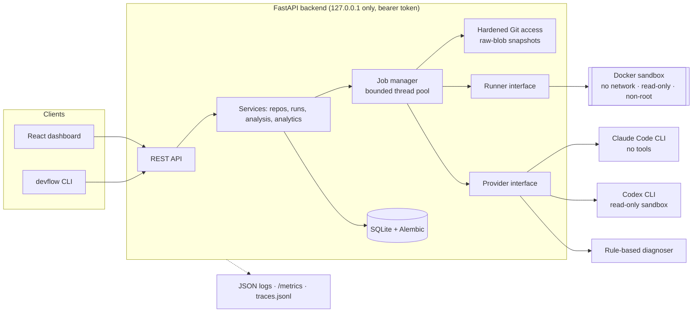
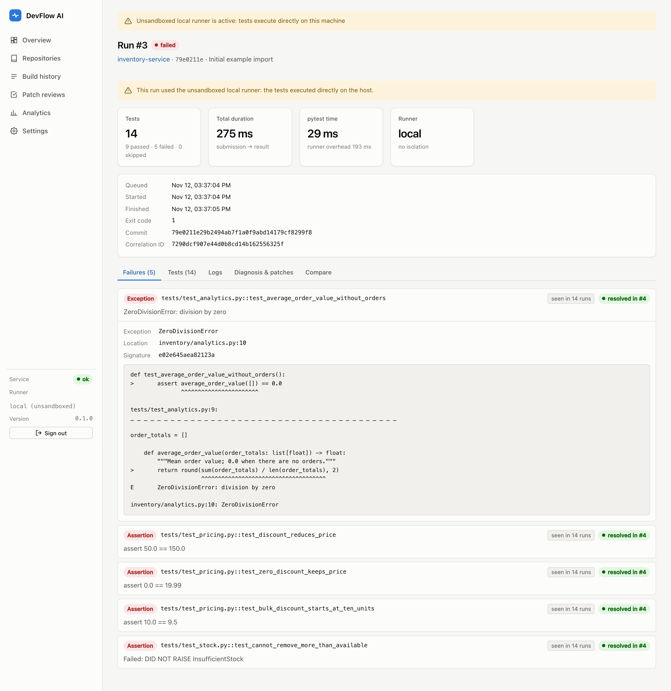
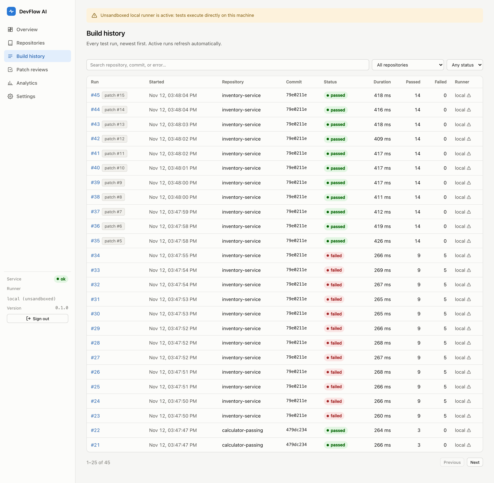
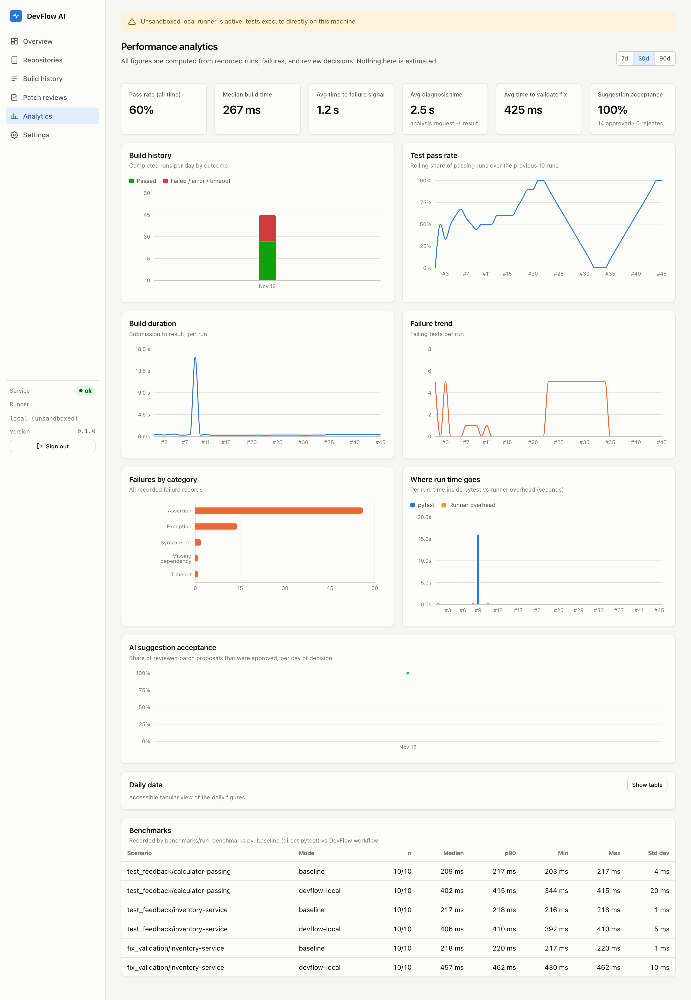
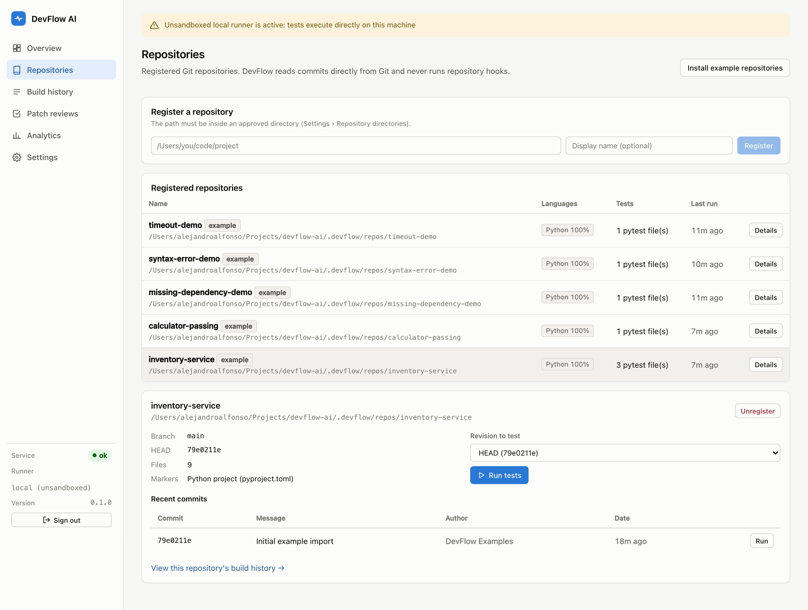
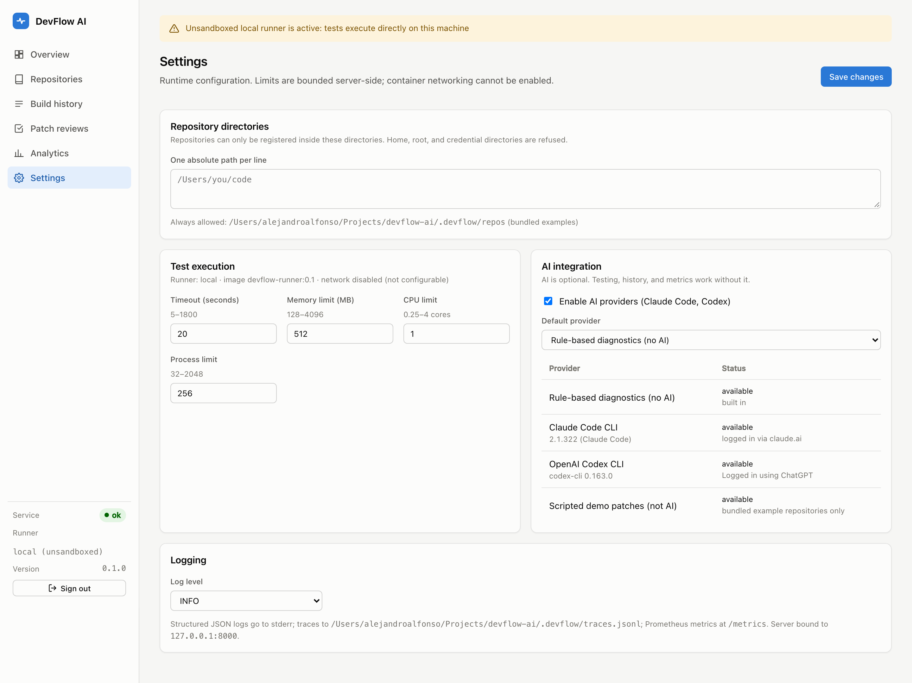

# DevFlow AI

**A local developer-productivity platform that closes the test-failure feedback loop:** it
runs a repository's test suite in an isolated Docker sandbox, classifies what failed,
optionally asks an AI coding agent (Claude Code or Codex) for a diagnosis and a minimal
patch, and puts every proposed change through a human review and a sandboxed retest
before anything can touch the repository.



> **Status (honest summary).** The full workflow is implemented and verified end to end
> on macOS (Apple Silicon) with the opt-in local runner, including real Claude Code and
> Codex analyses. The Docker sandbox runner is fully implemented and its command
> construction and failure handling are unit-tested, but **live container runs had not
> yet been executed on the development machine when this was written** (Docker Desktop
> was not installed); the live sandbox tests in `backend/tests/test_docker_sandbox.py`
> run in CI. See [Verification status](#verification-status).

---

## The problem

When a test fails, a developer typically: reruns the suite locally, scrolls through
output to find the failing assertion, opens the relevant files, forms a hypothesis,
edits, reruns, and repeats. Each step is manual and none of it is recorded, so teams
can't see which failures recur, how long diagnosis takes, or whether AI suggestions
actually help.

AI coding agents can shorten diagnosis, but running them against a real repository
raises its own problems: they can be steered by text in the repository (prompt
injection), they may propose changes that "fix" a test by weakening it, and their
output should never reach a codebase without review.

## What DevFlow AI does

| Capability | How |
|---|---|
| Register repositories | Local Git repos inside explicitly approved directories; language/structure detection from the Git tree |
| Run tests in isolation | Fresh Docker container per run: no network, read-only root FS, all capabilities dropped, non-root UID, CPU/memory/PID limits, wall-clock timeout |
| Understand failures | JUnit parsing, per-test results, tracebacks, logs; failures classified (assertion, exception, syntax error, missing dependency, timeout, collection, infrastructure) and fingerprinted to track repeats and resolutions |
| Diagnose | Pluggable providers: **Claude Code CLI**, **Codex CLI**, a **rule-based** non-AI diagnoser, and a clearly-labelled **scripted demo** provider |
| Propose fixes safely | Patches are statically validated (paths, binaries, symlinks, renames), risk-scored (e.g. "modifies tests", "adds subprocess calls"), dry-run applied |
| Human approval | Nothing is applied without an explicit decision; approval retests the patch in a sandbox against a fresh snapshot — the repository is untouched |
| Export | After a passing retest, an explicit, confirmed action writes the change to a **new branch** using Git plumbing (working tree, index, and HEAD untouched; nothing pushed) |
| Measure | Pass rate, build durations, time-to-failure-signal, time-to-validate-fix, diagnosis time, runner overhead, repeated/resolved failures, suggestion acceptance |
| Observe | Structured JSON logs with correlation IDs, Prometheus metrics, OpenTelemetry traces |
| Interfaces | REST API (OpenAPI docs), CLI (`devflow`), React dashboard |

## Architecture



The workflow for one failure:

```
submit ─► snapshot commit (git ls-tree + cat-file, no hooks/filters)
       ─► sandboxed pytest ─► JUnit ─► results + classified failures ─► dashboard
       ─► [optional] analysis: redacted context ─► provider ─► diagnosis + diff
       ─► validate + risk-score + dry-run apply ─► PROPOSED
       ─► human: reject  ─► recorded
       ─► human: approve ─► fresh snapshot + patch ─► sandboxed retest ─► compare
       ─► [optional, confirmed] export to new branch
```

Details: [docs/ARCHITECTURE.md](docs/ARCHITECTURE.md).

## Technology

- **Backend:** Python 3.12+ (developed on 3.14), FastAPI, Pydantic v2, SQLAlchemy 2, Alembic, SQLite (WAL)
- **Execution:** Docker (sandbox), pytest + pytest-timeout inside the runner image, Git plumbing
- **AI:** Claude Code CLI, OpenAI Codex CLI (both via their own logins), provider interface with non-AI fallback
- **Frontend:** React 19, TypeScript, Vite, Recharts, Vitest + Testing Library
- **Quality & security:** Ruff, mypy (strict), Bandit, pip-audit, npm audit, GitHub Actions
- **Observability:** prometheus-client, OpenTelemetry SDK, JSON logging

## Screenshots

All screenshots are of the running application with real recorded data (runs used the
local runner; see status note above).

| | |
|---|---|
|  Classified failures with tracebacks |  Diagnoses from Claude Code, Codex, rule-based and scripted providers, with patch review |
|  Searchable build history |  Performance analytics |
|  Repository management |  Settings |

## Quick start

### Requirements

| Tool | Version used | Notes |
|---|---|---|
| Python | 3.12+ (verified on 3.14.7) | no system Python changes; a project `.venv` is used |
| Node.js | 24 (npm 11) | dashboard build only |
| Git | 2.24+ (verified 2.39) | `--end-of-options` support |
| Docker | Docker Desktop / Engine 24+ | required for the sandboxed runner |
| Claude Code / Codex CLI | optional | only for AI analysis; must already be logged in |

### Install and run

```bash
git clone <this repo> devflow-ai && cd devflow-ai
make setup            # .venv + backend deps + frontend deps
make runner-image     # builds devflow-runner:0.1 (needs Docker)
make doctor           # checks git, docker, runner image, AI CLIs
make serve            # builds the dashboard, serves API + UI on http://127.0.0.1:8000
```

Then open <http://127.0.0.1:8000>, paste the token printed by `make token`, and click
**Repositories → Install example repositories**.

Without Docker, you can explore with the **unsandboxed** local runner (tests execute
directly on your machine; every run and page is labelled accordingly):

```bash
DEVFLOW_RUNNER=local DEVFLOW_ALLOW_UNSANDBOXED_RUNNER=true make serve
```

### Commands

| Task | Command |
|---|---|
| Start (production build) | `make serve` |
| Start (dev, hot reload) | `make dev` → UI on :5173, API on :8000 |
| Stop | `make stop` (or Ctrl-C) |
| Print API token | `make token` |
| All tests | `make test` |
| Docker sandbox tests | `make test-docker` |
| Lint / types | `make lint` / `make typecheck` |
| Security checks | `make security` |
| Everything CI runs | `make check` |
| End-to-end demo | `make demo` (add AI: `.venv/bin/python scripts/demo.py --ai claude-code`) |
| Benchmarks | `make benchmark` |

CLI examples (server must be running):

```bash
devflow repo examples              # install + register bundled examples
devflow repo list
devflow run 2                      # run tests for repository 2 and wait
devflow analyze 7 --provider heuristic
devflow patch show 3
devflow patch review 3 --approve --comment "minimal and correct"
devflow patch export 3             # asks for confirmation; writes a new branch
```

## Demonstration

`scripts/demo.py` drives the whole workflow through the API and reports each step as
PASS / FAIL / BLOCKED. It uses `examples/repos/inventory-service`, a small library with
four intentional bugs (5 failing tests out of 14). A run on the development machine:

```
[PASS] Server healthy - runner=local sandboxed=False
[PASS] 1. Register sample repository
[PASS] 2. Run tests with the UNSANDBOXED local runner - 9 passed, 5 failed in 275 ms
[PASS] 3. Detect failures - assertion, exception
[PASS] 4. Capture stack traces
[PASS] 5a. Rule-based diagnosis (no AI)
[PASS] 5b. AI diagnosis (claude-code) - Four independent bugs in the code under test ... (23873 ms, 1 patch)
[PASS] 6. Patch proposal (SCRIPTED DEMO, not AI)
[PASS] 7. Human review and approval
[PASS] 8. Apply to isolated snapshot and retest - 14/14 passed
[PASS] 9. Compare baseline and final results - 5 fixed, 0 regressed
[PASS] 10. Metrics recorded
12 passed, 0 failed, 0 blocked
```

The Claude Code patch from that run was then approved through the API and its sandboxed
retest passed 14/14. A Codex analysis of the same run identified the same four root
causes in 18.3 s; its first patch was **rejected by DevFlow's validation** because the
diff was malformed (a file header emitted as a context line). That real-world case led
to a narrow normalization fix with a regression test; see
[docs/SECURITY.md](docs/SECURITY.md#patch-validation).

If no AI provider is available, the **scripted demo** provider supplies pre-written
patches for the example repository. Its output is stored with `is_ai = false` and shown
as "SCRIPTED DEMO - NOT AI" everywhere.

## AI integration

| Provider | Invocation | Isolation |
|---|---|---|
| `claude-code` | `claude -p --output-format json --tools "" --strict-mcp-config --no-session-persistence` | **No tools at all**: the model can only return text |
| `codex` | `codex exec --sandbox read-only --ephemeral --ignore-user-config --ignore-rules --skip-git-repo-check -C <workspace> -o <file>` | Read-only sandbox, no network for commands; can still *read* files (residual risk) |
| `heuristic` | built in | deterministic rules, no patches |
| `demo` | built in | pre-written patches, example repos only |

- Both CLIs run in a throwaway workspace containing only the selected context files,
  with a scrubbed environment. `ANTHROPIC_API_KEY` / `OPENAI_API_KEY` are **removed** by
  default, so analyses use your existing CLI login (subscription) and never silently
  incur metered API charges (`DEVFLOW_AI_PASS_API_KEYS=true` to opt in).
- No approval-bypass flag (`--dangerously-*`, `--full-auto`, `bypassPermissions`, …) is
  ever passed; a unit test asserts this.
- Availability is detected via `claude auth status` / `codex login status`. A missing or
  logged-out CLI makes the provider "unavailable" and the UI offers the rule-based one.
- AI can be disabled entirely in Settings.

A subscription login is not the same as API access, and plan limits on automated use
apply; DevFlow makes one CLI call per analysis request, only when a user asks.

## GitHub Actions

`.github/workflows/ci.yml` runs on pull requests and pushes to `main`:

- **backend** (Python 3.12 and 3.14): Ruff lint + format check, mypy strict, pytest with coverage; JUnit + coverage uploaded as artifacts
- **docker-sandbox**: builds the runner image and runs the live sandbox tests
- **frontend**: typecheck, Vitest, production build (uploaded as artifact)
- **security**: Bandit, pip-audit, npm audit, workflow schema validation

Least privilege: `permissions: contents: read`, `persist-credentials: false`, the
`pull_request` trigger (never `pull_request_target`), no secrets, no publish or deploy.

## Security

Untrusted inputs are: repository contents, test output, provider output, and API input.
Key controls (full threat model and residual risks in [docs/SECURITY.md](docs/SECURITY.md)):

- API bound to `127.0.0.1`; non-loopback binding refused unless explicitly enabled
- Bearer token (generated, `0600`) on every API route except health; Host-header allowlist against DNS rebinding
- Repository paths resolved and confined to approved roots; sensitive home directories refused
- Git never runs hooks, filters, or `fsmonitor`; snapshots are built from raw blobs
- Single allowlisted process launcher, list arguments only, no `shell=True`, scrubbed environment
- Sandbox flags re-validated before every `docker run`; the Docker socket is never mounted into test containers
- Prompt content delimited and neutralized; injection phrases detected and surfaced to the reviewer
- Patch validation + risk scoring + dry-run + human approval + sandboxed retest; branch export requires explicit confirmation
- Secrets redacted from logs, stored output, and AI prompts

**Docker on macOS is not a perfect security boundary**; DevFlow is a local developer
tool and has not been through an external security review. Do not describe it as
production-safe.

## Benchmarks

`benchmarks/run_benchmarks.py` compares a manual baseline (clone + run pytest directly)
with the DevFlow workflow on identical scenarios, 10 measured iterations after 1 warmup.
Median results on an Apple Silicon MacBook Air, **local runner**:

| Scenario | Baseline | DevFlow | Difference |
|---|---|---|---|
| Test feedback, passing repo (3 tests) | 209 ms | 402 ms | DevFlow **+193 ms** slower |
| Test feedback, failing repo (14 tests) | 217 ms | 406 ms | DevFlow **+189 ms** slower |
| Fix validation (apply patch + rerun) | 218 ms | 457 ms | DevFlow **+238 ms** slower |

DevFlow is slower in raw wall-clock time for these tiny suites: it snapshots the commit,
records every result, and classifies failures. What it adds is in what you get back
(structured failures, history, comparison, isolation, review trail), not speed. Docker
runs will add container start-up cost on top; those numbers will be recorded with
`make benchmark` once measured. Methodology: [docs/BENCHMARKS.md](docs/BENCHMARKS.md).

## Verification status

| Item | Status |
|---|---|
| Backend starts; DB migrates and persists | Verified |
| Dashboard builds and serves real data | Verified (screenshots above) |
| Example repo registration; passing/failing detection; history; cancel; timeouts | Verified (local runner + 132 automated tests) |
| Rule-based fallback; scripted demo; approval; retest; compare; export | Verified |
| Claude Code analysis; Codex analysis | Verified with real CLI calls |
| Security checks (Bandit, pip-audit, npm audit, workflow schema) | Executed, clean |
| GitHub Actions workflow | Schema-validated; **not yet run on GitHub** (nothing has been pushed) |
| Docker sandbox runner live execution | **Not yet verified locally** (Docker not installed at time of writing) |
| `Dockerfile` / `compose.yaml` for the app image | Written; **not built** (no Docker) |

## Documentation

- [ARCHITECTURE.md](docs/ARCHITECTURE.md): components, data flow, database schema
- [SECURITY.md](docs/SECURITY.md): threat model, controls, residual risks
- [API.md](docs/API.md): endpoints and examples (interactive docs at `/docs`)
- [TESTING.md](docs/TESTING.md): test strategy and scenario coverage
- [BENCHMARKS.md](docs/BENCHMARKS.md): methodology and results
- [DEVELOPMENT.md](docs/DEVELOPMENT.md): setup, workflow, troubleshooting

## Known limitations

- Python/pytest repositories only. Other languages are detected but marked unsupported.
- Sandbox containers have no network, so dependencies must be in the runner image
  (`runner/requirements.txt`); repos needing other packages fail as "missing dependency".
- Single-user, single-process design (in-process job pool, SQLite). Not multi-tenant.
- Codex's read-only sandbox does not prevent reads of files the user can read.
- Rule-based diagnosis explains failures but does not generate patches.

## Future improvements

- Per-repository runner images built from lock files in an isolated, network-enabled build step
- gVisor or Kata Containers runtime for stronger isolation; rootless Docker on Linux
- Remote runners (SSH / Kubernetes) behind the existing `Runner` interface
- Flaky-test detection from failure signatures across reruns
- Structured patch output via `--output-schema` (Codex) / JSON schema (Claude)

## License

MIT
